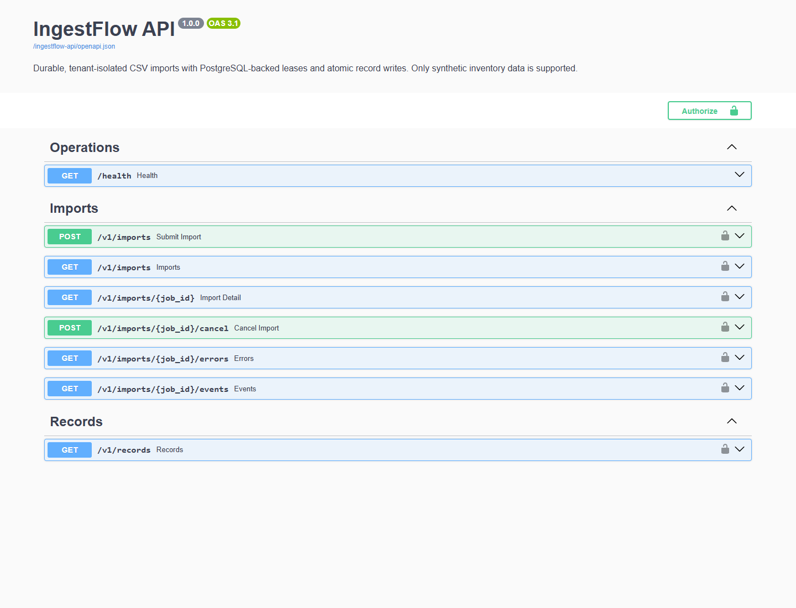

# IngestFlow API

Import a CSV inventory file, return a durable job ID, and let a separate Python worker validate and apply it. A failed row rejects the entire import. Retrying an HTTP submission with the same key and CSV bytes returns the original job.

The project demonstrates a REST API, PostgreSQL transactions, concurrent queue claims, lease recovery after a worker crash, and tenant boundaries. It uses synthetic inventory records. It has no dashboard or external storage service.



This image renders the committed OpenAPI contract with Swagger UI. It is API documentation, not a business dashboard or a recorded response from a running server.

## Stack

Python 3.13, FastAPI 0.162.0, Psycopg 3.3.6, PostgreSQL 17, Uvicorn 0.54.0, pytest 9.2.0, and Docker Compose. Runtime dependencies are pinned in `requirements.txt`. Test dependencies are in `requirements-dev.txt`.

## Run locally on Windows

Install Python 3.13 and Docker Desktop with Linux containers, then run from this folder:

```powershell
.\scripts\Init.ps1
.\scripts\Start.ps1
```

Open [interactive API documentation](http://127.0.0.1:8100/docs). Open `.local/LOCAL-CREDENTIALS.txt` locally and paste the alpha key into the Swagger **Authorize** dialog. Enter the key only, without an extra `Bearer` prefix. The beta key represents an independent tenant.

| Resource | Local address |
|---|---|
| API | `http://127.0.0.1:8100` |
| OpenAPI JSON | `http://127.0.0.1:8100/openapi.json` |
| PostgreSQL | `127.0.0.1:5454`, database/user `ingestflow` |
| Isolated test PostgreSQL | `127.0.0.1:5455`, database/user `ingestflow_test` |

`Init.ps1` creates random private tenant keys and a database password in `.env`. API and worker containers receive tenant key digests. They do not receive the raw tenant keys. Git ignores `.env` and `.local/`.

```powershell
.\scripts\Test.ps1          # Includes real PostgreSQL and worker-kill recovery tests
.\scripts\Stop.ps1          # Stops this project; preserves its database volume
```

The scripts store their temporary files and Python caches in this project's `.local/` directory and restore process environment variables afterward. Docker stores images and volumes at Docker Desktop's configured data location.

## Try an import

Use the [Postman collection](docs/IngestFlow.postman_collection.json), [HTTP examples](examples/smoke.http), or curl. Set `TENANT_KEY` privately in your terminal; do not put a real key in committed examples.

```sh
curl -i http://127.0.0.1:8100/v1/imports \
  -H "Authorization: Bearer $TENANT_KEY" \
  -H 'Content-Type: text/csv' \
  -H 'Idempotency-Key: demo-import-001' \
  --data-binary @examples/valid.csv
```

The response is `202 Accepted` with a job ID and a `Location` header. Follow that URL with the same tenant key, then read `/v1/records`. The worker normally claims a queued import on its next loop. Submitting `examples/invalid.csv` with a fresh key produces a `FAILED` job and row error codes, without applying its valid rows.

| Method | Route | Behavior |
|---|---|---|
| `GET` | `/health` | Check database connectivity and migration |
| `POST` | `/v1/imports` | Queue bounded UTF-8 CSV; `Idempotency-Key` required |
| `GET` | `/v1/imports` | List this tenant's jobs by sequence cursor |
| `GET` | `/v1/imports/{id}` | Read current job status |
| `POST` | `/v1/imports/{id}/cancel` | Cancel before an apply transaction wins the row lock |
| `GET` | `/v1/imports/{id}/errors` | Read a bounded validation report |
| `GET` | `/v1/imports/{id}/events` | Read persisted lifecycle events |
| `GET` | `/v1/records` | Read actual committed inventory records |

## What is guaranteed

- `(tenant, Idempotency-Key)` identifies one retained job. A tenant-prefixed SHA-256 digest detects different bytes, including newline differences, and returns `409` for conflicting reuse.
- PostgreSQL stores the CSV bytes before `202` is returned. The worker does not depend on an uploaded file path or API process memory.
- Workers claim jobs with `FOR UPDATE SKIP LOCKED`. Every claim receives a new lease token. An expired or replaced token cannot apply records.
- A successful import commits all record upserts, its final status, and its success event in one database transaction. SKUs are written in deterministic order.
- Cancellation locks the same job row as apply. A cancellation that commits first prevents its worker from publishing. If apply commits first, cancellation returns `409`.
- A killed worker leaves a recoverable `RUNNING` job. The worker recovers expired claims; after three claims the import fails rather than retrying forever.
- Every job, record, report, and event query uses the authenticated tenant. Another tenant's job ID returns `404`.

This is PostgreSQL atomicity with lease fencing. The project does not claim distributed exactly-once delivery or cross-service transactions.

## Bounds and limits

CSV must have the exact header `sku,name,quantity`, at most 256 KiB and 1,000 data records. SKU is case-sensitive ASCII: uppercase letters, digits, `_` and `-`, maximum 32 characters. Name is 1..100 characters without surrounding whitespace or control characters. Quantity is a canonical nonnegative integer up to 999999. Duplicate SKUs within one file reject the file.

Reports store at most 50 error entries and include the full detected count. CSV row numbers count logical CSV records, with header at 1. A file-size or encoding error uses row 0.

Each synthetic tenant may retain 200 jobs, including terminal jobs, and at most 50 queued/running jobs. Replays still work at capacity. There is no automatic retention purge, key rotation endpoint, real customer authentication, virus scanning, cross-request snapshot pagination, or external message broker. Different successful imports update overlapping SKUs in database commit order; there is no business-level ordering guarantee across concurrent imports.

## Read the code and demonstrate it

- [Per-file and per-function tutorial in Indonesian](docs/CODE-GUIDE.md)
- [Request contracts and error codes](docs/API.md)
- [Transactions, state machine and worker recovery](docs/ARCHITECTURE.md)
- [Local operations, testing and troubleshooting](docs/OPERATIONS.md)
- [Interview walkthrough](docs/INTERVIEW.md)
- [Dependency sources](docs/DEPENDENCIES.md)

CI starts PostgreSQL, runs the database and concurrency tests, kills a real worker subprocess after its claim commits, verifies recovery, starts the HTTP API and a separate worker, and checks their effects. See [the workflow](.github/workflows/verify.yml). Verification results belong in [VERIFICATION.md](docs/VERIFICATION.md); authored tests alone are not a passing result.
