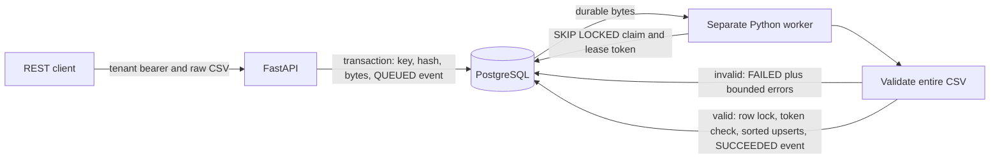
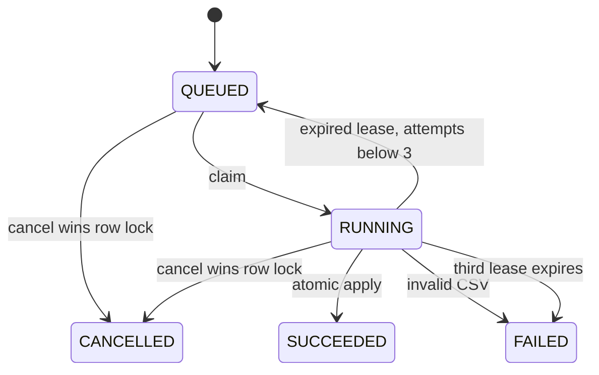

# Transactions and worker recovery

## Durable admission

`store.submit()` locks the tenant row. While holding it, the transaction checks existing `(tenant_id, idempotency_key)`, compares SHA-256 over `tenant ASCII + NUL + raw CSV bytes`, enforces tenant capacity, inserts the job, and appends its `QUEUED` event. The unique constraint is a second protection against duplicate jobs. The connection context commits before FastAPI serializes its `202` response.

If the database commit succeeds but the client loses the HTTP response, replaying the original key and bytes returns that job. Replaying a key with changed line endings is a conflict. Tenants can independently use the same textual key.

## Claim, validate, apply

`worker.claim()` recovers up to 50 expired running rows, using row locks and `SKIP LOCKED`. Attempts below three are requeued. The third expired attempt becomes `FAILED` with `lease_attempts_exhausted`. It then claims the oldest available queued row with the same locking technique, increments attempts, generates a UUID lease token, and commits a `CLAIMED` event. Production leases are 30 seconds.

CSV validation happens outside the database row lock. The 256 KiB / 1000-row bounds keep parser work bounded. The parser validates every encountered row and collects at most 50 field-level errors. It returns no candidate products when any error occurs.

`worker.complete()` locks the import row, checks status and exact lease token, then checks the database clock after acquiring the lock. Cancelled, expired, and replaced claims return without writes. The lock remains held through the apply transaction. If it was valid when apply began, another worker or cancellation cannot overtake it while it commits.

For valid CSV, records are upserted in ascending SKU order. The records, final counters, `SUCCEEDED` status, and success event share a transaction. An exception rolls back all these changes. Invalid CSV instead stores `FAILED`, bounded error details, and a failure event in one transaction.

There is no lease heartbeat. A slow validation attempt that loses its lease cannot publish; it is retried by the next recovery loop. The apply transaction's queries have a 10-second statement timeout and 5-second lock timeout. The database connection has a 5-second connect timeout.

## Cancellation and overlap

Cancellation and apply contend on the same row. The first committed terminal transition wins. A worker cannot resurrect a cancelled import because its token is checked under that row lock. Cancellation after a committed apply returns `409`.

Concurrent different imports may overlap SKUs. Deterministic SKU order reduces deadlock risk. PostgreSQL row locks serialize overlapping record writes. The application does not promise that submission order determines final record values. This is not a distributed exactly-once protocol.

## Tenant and storage boundaries

Two synthetic tenant identities, alpha and beta, are fixed for this demo. Private 64-hex keys are generated locally. API code compares SHA-256 digests using `compare_digest`; raw keys are not stored in PostgreSQL or passed into API/worker container environments. Every visible query includes tenant identity. The composite foreign key prevents a record from pointing to another tenant's import.

CSV bytes remain in PostgreSQL `bytea` after terminal completion. A tenant can retain 200 jobs; no automatic deletion is hidden in the worker. Data at rest is protected only by the host/database volume permissions. Network exposure is loopback on the local machine; remote deployment would need TLS, a trusted ingress, managed credentials, retention policy, monitoring, backups, and a real identity model.

## Failure evidence

The test suite uses real PostgreSQL with a fresh schema per test. A failpoint raises after the first product write to verify transaction rollback. The crash test launches `tests.claim_and_pause` in a real subprocess, waits for its durable claim marker, kills that process, waits until its one-second test lease expires, and lets a new claim finish. It asserts two claims, one lease recovery, one success event, and exactly the expected record effects. The test helper is absent from the runtime Docker target and no HTTP failpoint exists.
